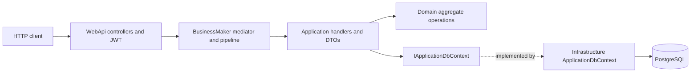

# Architecture

## Implemented system

This is a .NET 10 ASP.NET Core API for administering feature flags. It manages projects/members, features/tags/lifecycle, environments/tokens, per-feature environment strategies, reusable segments/constraints, users/authentication, and change-request state transitions. It is a single solution with four layers and one PostgreSQL persistence model; there is no separate read database or independently deployed service in this checkout.

## Execution and composition

`Program.cs` calls `AddServices`, builds the host, then `UseWebApiConfiguration`. Application registration initializes Mapster, the framework mediator, generated command/notification handlers, validation/performance/unhandled-exception behaviors, Microsoft JSON serialization, and in-memory caching. Infrastructure registers Npgsql DbContext, audit interception, user information, date-time support, data-protection key persistence, password hashing and JWT/refresh-token services.

Middleware starts with database seeding, exception handling, OpenAPI/Scalar, HTTPS redirection, permissive CORS, authentication, authorization, health endpoints, controllers and the API descriptor. Registration currently repeats Application/Infrastructure calls; this is a known observation, not an architecture requirement.

Controllers derive from local `ApiControllerBase` and upstream `BusinessApiControllerBase`, dispatching custom `ICommandRequest`/`IQueryRequest` through `SendAsync`. Commands return framework `Result`/`Result<T>`; queries return DTOs directly. The upstream controller maps success bodies directly rather than serializing the Result wrapper. See contract provenance and status caveats in [ts-contracts](ts-contracts/README.md).

## Domain and storage

Aggregate groups under `src/Domain/Aggregates`: Project, Feature, Environment, Segment, ApiToken, User, ChangeRequest. Child entities include project members, feature environments/strategies, change-request items and refresh tokens. Value objects include Constraint, StrategyParameters, Variant, Schedule and FeatureMetrics. Domain events exist, but their existence does not establish a complete external event bus or audit pipeline.

`ApplicationDbContext` extends framework `BaseCommandDbContext`, implements `IApplicationDbContext`/`IDataProtectionKeyContext`, applies assembly EF configurations and wraps `SaveChangesAsync` as `SaveChangeAsync`. Configurations include enum string storage, JSON/collection mappings, indexes and relationship deletion behavior. Existing migrations live under Infrastructure. Read actual mappings before modifying shared Constraint/Variant types or navigation loading.

## HTTP inventory

Business APIs use version 1.0, usually `/api/v1/<Controller>`; the feature-environment controller declares a nested route. Its inherited controller route may also create a route alias; verify generated OpenAPI before relying on aliases.

| Area | Operations | Contract |
| --- | --- | --- |
| Auth | login, refresh, logout, current user | [Auth.ts](ts-contracts/Auth.ts) |
| Users | CRUD subset, activate/deactivate, role | [Users.ts](ts-contracts/Users.ts) |
| Projects | CRUD, members, feature limit | [Projects.ts](ts-contracts/Projects.ts) |
| Features | create/read/update, archive, stale/impression flags, tags | [Features.ts](ts-contracts/Features.ts) |
| Environments | CRUD, enable/disable, token creation/revocation | [Environments.ts](ts-contracts/Environments.ts) |
| FeatureEnvironments | read, enable/disable, add/remove strategy | [FeatureEnvironments.ts](ts-contracts/FeatureEnvironments.ts) |
| Segments | CRUD, add/remove constraints | [Segments.ts](ts-contracts/Segments.ts) |
| ApiTokens | read/list with environment filter | [ApiTokens.ts](ts-contracts/ApiTokens.ts) |
| ChangeRequests | create/read, items, submit/review/apply/schedule/cancel | [ChangeRequests.ts](ts-contracts/ChangeRequests.ts) |
| Diagnostics/demo | Test plus Products/YTApi/Testxxxx | [Diagnostics.ts](ts-contracts/Diagnostics.ts) |

JWT validation is local (`JwtConfiguration`), with AdminOnly/EditorOrAbove policies registered but not automatically applied by plain `[Authorize]`. Do not infer row-level or role-level protection from policy registration. SDK evaluation, bootstrap, streaming, and API-key authentication described in the [archived proposal](specs/01-sdk-evaluation-proposal.specs.md) are not implemented source features. See [.ai/context.md](../.ai/context.md) for specific limitations.
